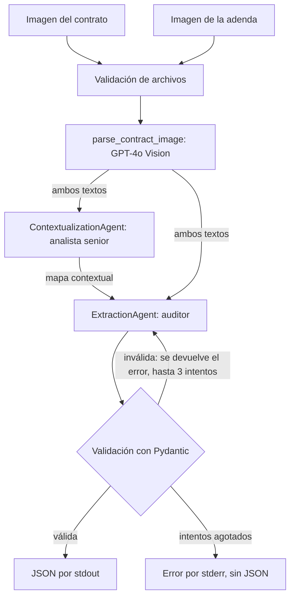

# Comparador de contratos con IA

Sistema multi-agente que compara un contrato con su adenda a partir de imágenes escaneadas y devuelve un JSON validado con los cambios. Es el proyecto integrador del Módulo 4 de AI Engineering en SoyHenry.

**El caso:** en LegalMove (empresa ficticia de la consigna), el equipo de Compliance dedica más de 40 horas semanales a comparar estos documentos a mano. Este sistema automatiza esa primera comparación.

## Arquitectura



| Archivo | Responsabilidad |
|---|---|
| `src/main.py` | Línea de comandos y orden del flujo |
| `src/image_parser.py` | Validación de imágenes, base64 y llamada multimodal |
| `src/agents/contextualization_agent.py` | Agente 1: mapa de la estructura; no describe cambios |
| `src/agents/extraction_agent.py` | Agente 2: extrae cambios y reintenta si la validación falla |
| `src/models.py` | Modelo `ContractChangeOutput` |
| `src/observabilidad.py` | Spans de Langfuse; el análisis funciona también sin Langfuse |
| `src/config.py`, `src/errores.py` | Variables de entorno y errores propios |
| `scripts/generar_contratos.py` | Genera los contratos ficticios de prueba |

## Instalación

Requiere Python 3.14, una clave de OpenAI con acceso a `gpt-4o` y, para las trazas, una cuenta de Langfuse.

```bash
python -m venv .venv
.venv\Scripts\activate          # Linux/macOS: source .venv/bin/activate
pip install -r requirements.txt
copy .env.example .env          # Linux/macOS: cp .env.example .env
```

Luego completa tus claves en `.env`. Sin claves de Langfuse, el análisis funciona igual, con un aviso.

## Uso

```bash
python src/main.py data/test_contracts/par_1_original.png data/test_contracts/par_1_adenda.png
```

También funciona `python -m src.main ORIGINAL ADENDA`. Stdout lleva solo el JSON; los avisos, los errores y la URL de la traza van por stderr.

Para guardar el JSON, usa Git Bash o PowerShell 7: en PowerShell 5.1, `>` cambia la codificación del archivo.

| Código de salida | Significado |
|---|---|
| 0 | Análisis correcto |
| 1 | Falló una etapa (API, respuesta inútil o validación agotada); no se emite JSON |
| 2 | Archivo o configuración inválidos; no se gasta API |

Variables opcionales: `OPENAI_MODEL` (`gpt-4o`), `OPENAI_TIMEOUT` (120), `OPENAI_MAX_ATTEMPTS` (3) y `OPENAI_MAX_TOKENS` (4096).

### Ejemplo real de salida (par 2)

```json
{
  "sections_changed": ["Cláusula 2", "Cláusula 6", "Cláusula 9"],
  "topics_touched": ["Pagos", "Depósito de garantía", "Seguro"],
  "summary_of_the_change": "MODIFICACIÓN: Cláusula 2. Canon cambia de USD 1.500 mensuales a USD 1.650 mensuales.\nELIMINACIÓN: Cláusula 6. Depósito de garantía de USD 3.000.\nADICIÓN: Cláusula 9. Seguro contra incendio por USD 50.000."
}
```

## Observabilidad

Cada ejecución crea una traza en Langfuse:

```text
contract-analysis
├── parse_original_contract     modelo, tokens, latencia, intentos, datos de la imagen
├── parse_amendment_contract    lo mismo
├── contextualization_agent     entrada, mapa de salida y llamada al modelo anidada
└── extraction_agent            entrada, JSON de salida y llamada al modelo anidada
    └── validation              un span por intento, con el error si lo hubo
```

Un error queda marcado como `ERROR` en su span, y la traza se envía aunque el proceso falle. La URL se imprime al comenzar el análisis, de modo que también está disponible si algo falla.

## Decisiones técnicas

- **Dos agentes sin herramientas ni supervisor.** El orden de los pasos es siempre el mismo; un bucle de agente sumaría costo y riesgo sin aportar nada. El traspaso es explícito: el mapa del primero entra al segundo.
- **SDK de OpenAI para leer imágenes y LangChain para los agentes.** La consigna reserva LangChain para los agentes, y el SDK deja los tokens a mano para Langfuse.
- **El tipo de cambio va dentro del resumen.** La consigna pide distinguir adiciones, eliminaciones y modificaciones, pero el esquema solo admite tres campos. Por eso el resumen usa las etiquetas `ADICIÓN:`, `ELIMINACIÓN:` y `MODIFICACIÓN:`.
- **Si algo falla, no hay JSON.** Un JSON con listas vacías se confundiría con "no hubo cambios", y eso en un proceso legal es peor que un error visible.
- **Una cláusula no mencionada no está eliminada.** Muchas adendas solo enumeran lo que cambia; el prompt del auditor distingue ese caso del de una adenda que reformula todo el contrato.
- **Lo ilegible no se adivina.** El modelo marca `[ILEGIBLE]`, el programa avisa y el auditor no puede presentar eso como un cambio seguro.
- **Los documentos son datos.** Los prompts prohíben obedecer instrucciones escritas dentro de un contrato.
- **Reintento con el error de validación.** Si la salida no cumple el esquema, el modelo recibe el error para corregirlo.
- **El tipo de imagen se detecta por su contenido.** Una extensión mal puesta no engaña al programa, y una imagen cortada se rechaza antes de gastar API.
- **La imagen no se envía a Langfuse.** El base64 pesa mucho y es contenido legal; se registran ruta, formato, dimensiones y tamaño.

## Qué se reutilizó del curso

| Origen | Qué se tomó |
|---|---|
| Módulo 4, `vision_engine.py` | Envío en base64, regla de no inventar y reintento con el error de validación (adaptados de Gemini y Groq a OpenAI) |
| Módulo 3, clases 03 y RAG | `with_structured_output` y `model_validate` |
| Módulo 1, proyecto integrador | Reintentos ante fallos de la API; stdout solo para el JSON |

Langfuse no aparece en las carpetas del curso; su uso parte de un proyecto anterior del autor, con el SDK 4.17.

## Resultados medidos

Corridas reales del 1 de noviembre de 2026 con GPT-4o (`gpt-4o-2024-08-06`, según Langfuse), una por par, con los contratos de [`data/test_contracts/`](data/test_contracts/README.md). Las salidas están en [`outputs/`](outputs/).

| Par | Tipo de adenda | Cambios esperados | Detectados | Falsos | Trampa | Latencia | Costo según Langfuse |
|---|---|---|---|---|---|---|---|
| 1 | Reformula todo, escaneo limpio | 4 | 4 | 0 | — | 13,0 s | USD 0,0225 |
| 2 | Solo enumera, con ruido de escaneo | 3 | 3 | 0 | Cláusula 7 no eliminada: correcto | 10,3 s | USD 0,0188 |

No hubo reintentos en estas corridas. La comparación con `esperado.json` fue manual.

**Problema encontrado en la primera corrida real:** el análisis salió bien, pero la URL de la traza no se imprimió y Langfuse mostró `Context error: No active span`. El programa pedía la URL con la traza ya cerrada, y el doble de prueba no imitaba ese comportamiento. Se corrigieron la prueba y el código, y las cifras de la tabla son de la corrida posterior.

**Límites de esta medición:** son solo 2 pares ficticios, cortos, de una página y con una corrida cada uno. Sirven para comprobar que el flujo funciona, no para estimar su precisión en documentos reales. Tampoco miden qué tan bien responde con escaneos muy degradados o con letra manuscrita.

## Pruebas

```bash
python -m pytest tests/ -q
```

Las pruebas no llaman a OpenAI ni a Langfuse y no necesitan un `.env`.

## Limitaciones

- Cada documento debe ser una sola imagen; no procesa varias páginas ni PDF.
- Un resultado no reemplaza la revisión legal: sirve como primera comparación para el equipo de Compliance.
- El tipo de cambio viaja como texto dentro del resumen, porque el esquema pedido no tiene un campo propio para él.
